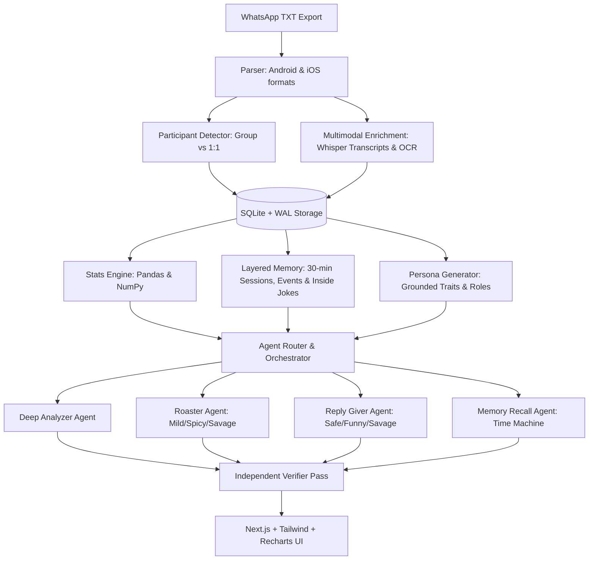

# 🚀 ChatChase: Multi-Agent Chat Intelligence Platform

> **PS 04 / Mission 04: Agentic Chase**  
> An Evidence-First Chat Intelligence Platform that transforms exported WhatsApp conversations into a verifiable, searchable memory brain.

---

## 💡 The Core Principle

> **CODE does the counting. AI does the language. EVIDENCE proves every claim.**

1. **Deterministic Counting (Python / Pandas / SQL):**  
   Metrics like conversation drivers, message counts, voice notes, average reply latency, and hourly activity heatmaps are computed deterministically with code. The LLM is never allowed to guess numbers.
2. **Immutable Evidence Citations (`[#seq]`):**  
   Every claim made by an AI agent must cite exact message sequence IDs (e.g. `[#28]`).
3. **Independent Verifier Engine:**  
   Before responses are displayed, an independent Verifier checks that each cited ID exists in the database and that the quoted text actually matches the original message. Unverified claims are flagged or rejected with an audit badge.

---

## 🛠️ Architecture & Tech Stack



- **Frontend:** Next.js 14, React 18, Tailwind CSS, Recharts, Lucide Icons.
- **Backend:** FastAPI, Python 3.12, Pandas, NumPy, Scikit-Learn, SQLite with WAL mode.
- **Agents & Memory:** Top-down hierarchical retrieval, 4 specialized agents, tool calling, and citation verification.
- **Multimodal:** Whisper-style voice note transcription (Bengali, Hindi, English), OCR captions, and video summaries attached directly to the message timeline.

---

## ⚡ Quick Start

### 1. Prerequisites
- Python 3.10+
- Node.js 18+ and npm

### 2. Run Automated Setup & Launch
Simply double-click `run_app.bat` or run:
```bash
# 1. Run tests to verify the suite
run_tests.bat

# 2. Launch both backend and frontend together
run_app.bat
```
- **Backend:** [http://127.0.0.1:8000](http://127.0.0.1:8000) (Docs at `/docs`)
- **Frontend:** [http://localhost:3000](http://localhost:3000)

---

## 🧪 Step-by-Step Manual Run

### Backend
```bash
# Activate venv
.\venv\Scripts\activate

# Seed Suman Demo Scenario
python -m backend.sample_data.seed_demo

# Start FastAPI server
python -m uvicorn backend.app.main:app --host 127.0.0.1 --port 8000 --reload
```

### Frontend
```bash
cd frontend
npm run dev
```

---

## 🎬 End-to-End Demo Scenario Walkthrough (PS 04)

You can click **"Quick Load 'Suman' Demo"** in the sidebar at any time to seed this scenario instantly:

1. **Project & Chat Workspace:**
   - Creates project **"Suman"**.
   - Ingests **"College Friends"** (automatically classified as **Group Chat** with **20 members**).
   - Ingests **"Shrimant"** (automatically classified as **1:1 Direct Conversation**).

2. **Query 1: Deep Analyzer**
   - *Question:* `"Who drives most conversations and how did the group's mood change over the year?"`
   - *Outcome:* Evaluates exact message shares via Pandas (**Suman leads with 18.4% of messages**), plots monthly mood index (63/100 rising to 78/100 during Goa trip), and cites message records like `[#4] [#5]`.

3. **Query 2: Roaster Agent (Spicy Tone)**
   - *Question:* `"Roast Shrimant for his voice-note habits at Spicy level"`
   - *Outcome:* Pulls exact voice note counts (3 voice notes logged) and roasts Shrimant for broadcasting radio podcasts instead of typing:
     > *"🌶️ [Spicy Roast] Shrimant, who told you that sending 3 voice notes is a valid substitute for regular texting? [#7]... If we wanted to hear an aspiring RJ summarize a 3-word reply across two separate 90-second audio files, we would tune in to 98.3 FM! Next time, just type 'haan bhai' like a normal human being."*

4. **Query 3: Reply Giver Agent**
   - *Question:* `"How should I reply to Shrimant?"`
   - *Outcome:* Generates 3 reply styles (Safe, Funny, Savage) cloned from real conversational context with authentic bilingual Bengali-English banter (*"Arre bhai Shrimant, tor voice note shunte shunte amar phone er battery 100 theke 20% hoye gelo! 😂"*).

5. **Query 4: Memory Recall (Time Machine)**
   - *Question:* `"When did we plan the Goa trip?"`
   - *Outcome:* Returns the date (**2024-12-14**), people involved (**Suman, Shrimant, Priya, Rahul, Aniket**), and cites exact messages `[#28] [#29] [#31] [#32] [#33]`.

6. **Interactive Evidence Inspector:**
   - Clicking any yellow citation chip (e.g. `[#28]`) in the chat opens the Evidence Inspector in the right panel, displaying the exact sender, timestamp, original text, and verification audit badge.

7. **Data Isolation & Deletion:**
   - Clicking the trash button next to any chat permanently purges all its messages, personas, session summaries, and event memory from disk.

---

## 🛡️ Safety & Guardrails Policy

- **Habit-Targeted Only:** Roasts are strictly confined to chat habits (voice note spam, ghosting, late replies, late-night texting).
- **Prohibited Attributes:** Zero attacks on religion, caste, race, health, physical appearance, family, trauma, or finances. An automated moderation layer scans every roast before display.
- **Strict Isolation:** Data is segmented by `project_id` and isolated across independent SQLite tables and vector spaces.

---

## 📁 Repository Structure

```
├── backend/
│   ├── app/
│   │   ├── main.py                  # FastAPI server & endpoints
│   │   ├── config.py                # App configuration
│   │   ├── models/                  # Pydantic schemas & SQLite models
│   │   ├── ingestion/               # WhatsApp parser, participant detector, multimodal enricher
│   │   ├── memory/                  # Layered memory engine, sessions, persona generator
│   │   ├── stats/                   # Python / Pandas statistical analysis
│   │   ├── agents/                  # 4 specialized agents + router + verifier
│   │   └── safety/                  # Ethical roasting & moderation guardrails
│   ├── sample_data/                 # Sample WhatsApp exports & seed demo script
│   └── tests/                       # Automated test suite (9 passing tests)
├── frontend/
│   ├── src/
│   │   ├── app/                     # Next.js App Router (page.tsx, layout.tsx, globals.css)
│   │   ├── components/              # Sidebar, AgentChat, EvidencePanel, PersonaCards, Dashboards, RoastCard
│   │   └── lib/api.ts               # Backend API client
│   ├── tailwind.config.js
│   └── package.json
├── run_app.bat                      # One-click start script
├── run_backend.bat                  # Backend launcher
├── run_frontend.bat                 # Frontend launcher
└── README.md
```

